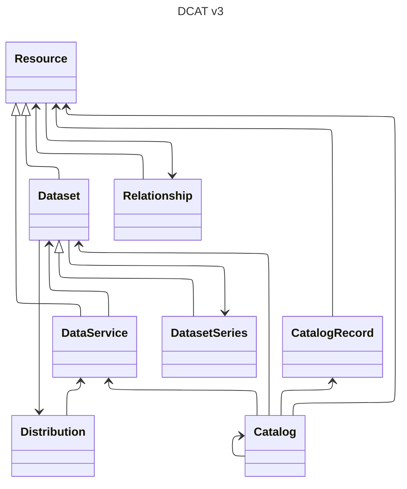

# Dedicate: Model-Level Mapping between DDI and DCAT

## Introduction

Here we document the model-level mapping between DDI and DCAT, or more precisely from the different DDI products (Codebook, Lifecycle and CDI) to DCAT.

Since the aim is to produce metadata conforming to DCAT profiles, the document is organized according to the DCAT model. Each main section corresponds to a DCAT class, and is further divided according to the DDI product which is source of the mapping.

The DCAT model is detailed [in the Recommendation](https://www.w3.org/TR/vocab-dcat-3/#fig-dcat-all-attributes); a summary view of its structure is given below.



## DCAT Resource

The DCAT Recommendation defines the [Resource class](https://www.w3.org/TR/vocab-dcat-3/#Class:Resource) by: "This class carries properties common to all cataloged resources, including datasets and data services". This class is mainly useful to catalog resources that are not datasets or data services, so we may ignore it in this mapping exercice. However, it bears a great number of properties that are inherited by Dataset and DataService. These properties will be studied in the next section.

## DCAT Dataset

The DCAT Recommendation defines the [Dataset class](https://www.w3.org/TR/vocab-dcat-3/#Class:Dataset) as a "collection of data, published or curated by a single agent, and available for access or download in one or more representations".

### Identification

❗️TODO document how to identify an DCAT Dataset (its URI)

### DDI Lifecycle

What DDI-L class corresponds to the DCAT Dataset?

How do we obtain the Dataset properties from DDI-L metadata? We start from StudyUnit `Citation` / `Coverage` (where catalogue DCAT enrichment now lives, PhysicalInstances are distributions / tables). 

Core DCAT-AP properties plus the StudyUnit support:

| Property | DDI Lifecycle (StudyUnit) | Notes |
| --- | --- | --- |
| `dct:title` | `Citation/Title` | mandatory |
| `dct:description` | `Citation/Description` **or** `Citation/dcterms:description` |  |
| `dct:creator` | `Citation/Creator` (`CreatorName`) | `foaf:Agent` |
| `dct:publisher` | `Citation/Publisher` (`PublisherName`) | `foaf:Agent` |
| `dcat:contactPoint` | `ContactInformation` if present, else `Citation/Contributor` | |
| `dct:language` | `Citation/Language` | |
| `dct:identifier` | `Citation/InternationalIdentifier/IdentifierContent` | |
| `dct:source` / `conformsTo` / `accessRights` / `accrualPeriodicity` / `modified` | `Citation/dcterms:*` | URI-shaped values become IRIs |
| `dcat:keyword` | `Coverage/TopicalCoverage/Keyword` | text + `xml:lang` |
| `dcat:theme` | `Coverage/TopicalCoverage/Subject` (`controlledVocabularyURN`) | not Keyword |
| `dct:spatial` | `Coverage/SpatialCoverage` | `dcterms:Location` |
| `dct:temporal` | `Coverage/TemporalCoverage/ReferenceDate` | `dcterms:PeriodOfTime` + `dcat:startDate` / `endDate` |
| `dcat:distribution` | `PhysicalInstanceReference` -> PhysicalInstance | one Distribution per PI |

#### `dct:title` / `dct:description`

`Citation/Title` -> `dcterms:title`. Description prefers `Citation/dcterms:description` (catalogue binding) and still accepts classic `Citation/Description`.

#### `dct:creator` / `dct:publisher` / `dcat:contactPoint`

Bibliographic names under Creator / Publisher become `foaf:Agent`. Contact prefers structured `ContactInformation`, otherwise Contributor names become `vcard:Kind` / `vcard:fn`.

#### `dcat:keyword` / `dcat:theme`

Keywords are free-text `TopicalCoverage/Keyword`. Themes come from `TopicalCoverage/Subject` via `controlledVocabularyURN` (e.g. data-theme `HEAL`). Legacy Keyword-as-URI still maps to theme for older DDI.

#### `dct:spatial` / `dct:temporal`

Spatial -> blank `dcterms:Location` (`rdfs:label` from Description, `dcterms:identifier` from CountryCode). Temporal -> `dcterms:PeriodOfTime` with `dcat:startDate` / `dcat:endDate` from `ReferenceDate` Start/End/SimpleDate.

## DCAT Distribution

The DCAT Recommendation defines the [Distribution class](https://www.w3.org/TR/vocab-dcat-3/#Class:Distribution) as follows:

"A specific representation of a dataset. A dataset might be available in multiple serializations that may differ in various ways, including natural language, media-type or format, schematic organization, temporal and spatial resolution, level of detail or profiles (which might specify any or all of the above)."

### DDI Lifecycle

What DDI-L class corresponds to the DCAT Distribution?

How do we obtain the Distribution properties from DDI-L metadata? As for the the dataset, we can start with properties used in DCAT-AP, which are:

| Property        | Range                 | DCAT-AP status |
| --------------- | --------------------- | -------------- |
| dcat:accessURL  | rdfs:Resource         | mandatory      |
| dct:description | rdfs:Literal          | recommended    |
| dct:format      | dct:MediaTypeOrExtent | recommended    |

> [!NOTE]  
> DCAT-AP also recommmends the "availability" property, but this is an extension not defined in DCAT.

How do we derive the property that links a dataset to a distribution?

#### `dcat:accessURL`

The `PhysicalInstance` class in Lifecycle has a [`DataFileIdentification`](https://ddialliance.github.io/ddimodel-web/DDI-L-3.3/composite-types/DataFileIdentificationType/) field for which the documentation explains:

> Identifies the data file documented in the physical instance and provides information about its location.

More specifically, `DataFileIdentification` has a `DataFileURI` property.

#### `dct:description`

For this, we should probably use the [`Citation`](https://ddialliance.github.io/ddimodel-web/DDI-L-3.3/composite-types/CitationType/) property. It provides several "DC-like" fields and the possibility to add any Dublin Core terms with `DCTerms` ([here](https://docs.ddialliance.org/DDI-Lifecycle/3.3/xmlschema/schemas/dc_xsd/elements/any.html) is the XML schema doc for this).

#### `dct:format`

The most direct way to implement this is to use as mentionned earlier the `Citation` element.

We could also consider the use of the `FileFormat` property of `PhysicalStructure`. The latter is linked to the `PhysicalInstance` through its `RecordLayout`.

## DCAT Catalog

The DCAT Recommendation defines the [Catalog](https://www.w3.org/TR/vocab-dcat-3/#Class:Catalog) as such:

"A curated collection of metadata about resources."

With two usage notes:

"A Web-based data catalog is typically represented as a single instance of this class."

"Datasets and data services are examples of resources in the context of a data catalog."

### DDI Lifecycle

[The DCAT-AP entry for Catalog](https://semiceu.github.io/DCAT-AP/releases/3.0.1/#Catalogue) defines these three mandatory properties:

| Property        | Range        | DCAT-AP status |
| --------------- | ------------ | -------------- |
| dct:title       | rdfs:Literal | mandatory      |
| dct:description | rdfs:Literal | mandatory      |
| dct:publisher   | dct:Agent    | mandatory      |

The DDI Lifecycle `Organization` is a good starting point for these informations.

#### `dct:title`

Here, a generated text of the form: "Catalog for [Organization/OrganizationIdentification/OrganizationName]" would be a good fit.

#### `dct:description`

Same as above.

#### `dct:publisher`

Here use the relevant information from Organisation that corresponds to the `dct:publisher` property.

## Dataset structure / variables (HealthDCAT-AP + CSVW)

Core DCAT-AP does not describe dataset variables. HealthDCAT-AP does, via CSVW:

- `healthdcatap:hasStructuredData` on the Dataset
- `healthdcatap:hasVariables` -> `csvw:TableGroup` -> `csvw:Table` -> `csvw:Column`

SSSOM records live in the `variables` mapping set of
[`ddi-lifecycle-dcat-ap-mapping.ttl`](./ddi-lifecycle-dcat-ap-mapping.ttl).

### DDI Lifecycle attachment path

```text
StudyUnit                    ->  dcat:Dataset
  + healthdcatap:hasVariables ->  ONE csvw:TableGroup (per Dataset)
  PhysicalInstanceReference
    PhysicalInstance         ->  dcat:Distribution
      DataRelationshipReference
        DataRelationship
          LogicalRecord      ->  csvw:Table  (all records of the StudyUnit
                                               aggregated in that TableGroup)
            VariablesInRecord / VariableUsedReference
              Variable       ->  csvw:Column
```

HealthDCAT-AP R8: `hasVariables` is 0..*, but a TableGroup is the container for one or more tables, with one `csvw:Table` per LogicalRecord / PhysicalInstance.

Prefer variables listed in `VariablesInRecord` for the LogicalRecord linked from
the PhysicalInstance. Do not dump every Variable in the ResourcePackage unless
that scoped path is missing.

### Column property mapping

| DDI Lifecycle | CSVW / DCT | Notes |
| --- | --- | --- |
| `Variable` | `csvw:Column` | Column IRI = Variable URN |
| `VariableName` | `csvw:name` | Machine name |
| `Label` | `csvw:title` | Multi-language |
| `Description` | `dcterms:description` | Multi-language |
| `UserID` | `dcterms:identifier` | Optional business id (e.g. ExampleID) |
| `RecommendedDataType` (or representation class) | `csvw:datatype` | Map to XSD IRIs; see SSSOM comment |
| `ConceptReference` / Concept URI | `csvw:propertyUrl` | Provisional; omit if absent — do not invent DPV-PD URIs |

### Open points

- See open questions at the top of the SSSOM file (`propertyUrl`, `RecommendedDataType`).
- Code lists / coding systems: out of scope for this first variables set.
- XSL implementation: [`ddi-l-to-healthdcat-ap/xsl/ddi-lifecycle-to-dcat-ap.xsl`](./ddi-l-to-healthdcat-ap/xsl/ddi-lifecycle-to-dcat-ap.xsl).
