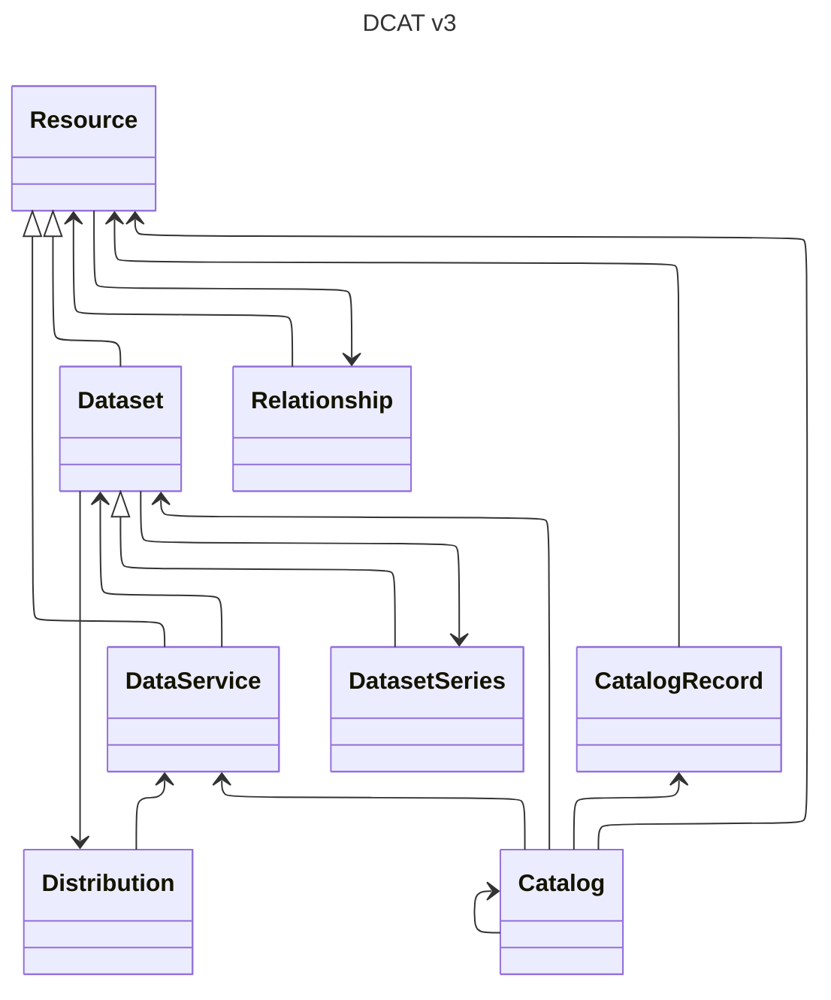
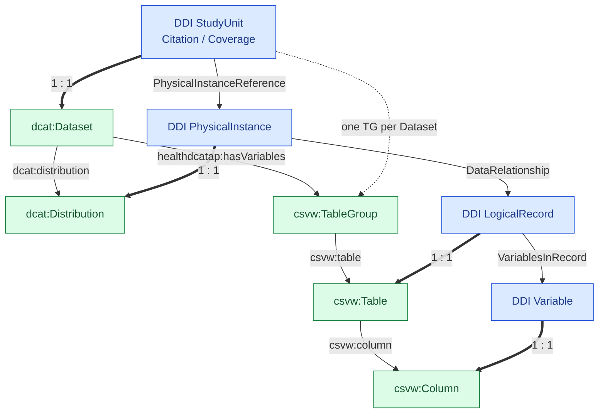

# Dedicate: Model-Level Mapping between DDI and DCAT

## Introduction

Here we document the model-level mapping between DDI and DCAT, or more precisely from the different DDI products (Codebook, Lifecycle and CDI) to DCAT.

Since the aim is to produce metadata conforming to DCAT profiles, the document is organized according to the DCAT model. Each main section corresponds to a DCAT class, and is further divided according to the DDI product which is source of the mapping.

The DCAT model is detailed [in the Recommendation](https://www.w3.org/TR/vocab-dcat-3/#fig-dcat-all-attributes); a summary view of its structure is given below.



## DCAT Resource

The DCAT Recommendation defines the [Resource class](https://www.w3.org/TR/vocab-dcat-3/#Class:Resource) by: "This class carries properties common to all cataloged resources, including datasets and data services". This class is mainly useful to catalog resources that are not datasets or data services, so we may ignore it in this mapping exercice. However, it bears a great number of properties that are inherited by Dataset and DataService. These properties will be studied in the next section.

## DDI to HealthDCAT-AP

Overview of how DDI Lifecycle projects onto HealthDCAT-AP / CSVW objects.

Property-level detail follows in the following sections:

- [Dataset](#dcat-dataset)
- [Distribution](#dcat-distribution)
- [variables / CSVW](#dataset-structure--variables-healthdcat-ap--csvw)



Organisation below follows HealthDCAT-AP Release 8 Dataset property tables (cardinality / EHDS requirements).

✅ = XSL implements the mapping (emitted when the DDI source field is present); ❌ = not implemented yet. Missing DDI fields are omitted.

### DCAT Dataset

The DCAT Recommendation defines the [Dataset class](https://www.w3.org/TR/vocab-dcat-3/#Class:Dataset) as a "collection of data, published or curated by a single agent, and available for access or download in one or more representations".

#### Identification

❗️TODO document how to identify an DCAT Dataset (its URI)

#### DDI Lifecycle

A DDI `StudyUnits` produces one `dcat:Dataset`.

Bibliographic / coverage fields come from `Citation` and `Coverage`.

Linked PhysicalInstances become Distributions, LogicalRecords / Variables become the CSVW TableGroup (see [Dataset structure / variables](#dataset-structure--variables-healthdcat-ap--csvw)).

##### Mandatory

Properties with cardinality requiring at least one value in HealthDCAT-AP R8 (or mandatory when `hasStructuredData` is true).

###### `dct:title` ✅

`Citation/Title/String` -> `dcterms:title` (multi-language).

###### `dct:description` ✅

Prefers `Citation/dcterms:description`; also accepts classic `Citation/Description` (`Content` / `String`) -> `dcterms:description`.

###### `dct:identifier` ✅

`Citation/InternationalIdentifier/IdentifierContent` -> `dcterms:identifier`.

###### `dct:accessRights` ✅

`Citation/dcterms:accessRights` -> `dcterms:accessRights`. Whole-value URIs, or catalogue strings `Label (https://…)`, become IRIs, otherwise kept as language-tagged literals.

###### `dcatap:applicableLegislation` ❌

No DDI Lifecycle binding yet (catalogue holds ELI URIs). Not emitted.

###### `healthdcatap:healthCategory` ❌

EHDS Art. 51 CV. No StudyUnit field mapped; not emitted.

###### `healthdcatap:hdab` ❌

Health data access body (`healthdcatap:hdab`). Not emitted.

###### `healthdcatap:hasStructuredData` ✅

Derived: `true` when the StudyUnit’s PhysicalInstances expose variables via LogicalRecord / `VariablesInRecord`. Not read from a DDI boolean field.

###### `healthdcatap:hasVariables` ✅

When structured data is true: one `csvw:TableGroup` per Dataset (see [Dataset structure / variables](#dataset-structure--variables-healthdcat-ap--csvw)). Mandatory in HealthDCAT-AP whenever `hasStructuredData` is `true`.

##### Recommended

Core discoverability / DCAT-AP-style recommended properties (and HealthDCAT-AP "Reuse" E/A with optional cardinality).

###### `dct:publisher` ✅

`Citation/Publisher` (`PublisherName` / `OrganizationName`) -> `foaf:Agent` / `foaf:name`.

###### `dcat:contactPoint` ✅

Prefers structured `ContactInformation` -> `vcard:Kind`; else `Citation/Contributor` names -> `vcard:fn`.

###### `dcat:distribution` ✅

Each `PhysicalInstanceReference` -> `dcat:distribution` (one Distribution per PhysicalInstance).

###### `dcat:keyword` ✅

`Coverage/TopicalCoverage/Keyword` (text + `xml:lang`) -> `dcat:keyword`. Legacy Keyword carrying a CV URI still maps to `dcat:theme`.

###### `dcat:theme` ✅

`Coverage/TopicalCoverage/Subject` + `controlledVocabularyURN` -> `dcat:theme` IRI.

###### `dct:language` ✅

`Citation/Language` -> `dcterms:language` (IRI if URI-shaped, else literal).

###### `dct:accrualPeriodicity` ✅

`Citation/dcterms:accrualPeriodicity` -> `dcterms:accrualPeriodicity` (HealthDCAT-AP "frequency"). Same URI / `Label (URI)` rule as `accessRights`.

###### `dct:spatial` ✅

`Coverage/SpatialCoverage` -> blank `dcterms:Location` (`rdfs:label` from Description, `dcterms:identifier` from CountryCode).

###### `dct:temporal` ✅

`Coverage/TemporalCoverage/ReferenceDate` -> `dcterms:PeriodOfTime` with `dcat:startDate` / `dcat:endDate`.

###### `dct:modified` ✅

`Citation/dcterms:modified` -> `dcterms:modified`.

###### `dct:conformsTo` ✅

`Citation/dcterms:conformsTo` -> `dcterms:conformsTo`. Same URI / `Label (URI)` rule as `accessRights` (SNDS-TS keeps prose literals today).

###### `dct:creator` ✅

`Citation/Creator` -> `foaf:Agent` / `foaf:name`.

###### `dct:type` ❌

Dataset type CV. No StudyUnit mapping; not emitted.

###### `dcat:version` ❌

No StudyUnit field read by the XSL (`pi:DataFileVersion` on PhysicalInstance is out of scope for Dataset today).

###### `dcat:temporalResolution` ❌

Not mapped from DDI Coverage / Citation.

###### `dct:issued` ❌

Release date (`dct:issued`). Not mapped.

###### `adms:identifier` ❌

Other identifier. Not mapped.

###### `dcat:inSeries` ❌

Dataset series membership. Not mapped.

##### Other

Remaining HealthDCAT-AP Dataset properties (optional / profile extensions).

###### `dct:source` ✅

`Citation/dcterms:source` -> `dcterms:source`.

###### `dct:provenance` ❌

Not mapped (catalogue text exists upstream; no DDI Note / ProvenanceStatement binding yet).

###### `dct:alternative` ❌

Not mapped.

###### `dcat:landingPage` ❌

Not mapped (`foaf:page` / documentation also ❌).

###### `foaf:page` ❌

Documentation. Not mapped.

###### `dcat:hasVersion` ❌

Not mapped.

###### `dcat:isReferencedBy` ❌

Not mapped.

###### `dcat:qualifiedRelation` ❌

Not mapped.

###### `prov:qualifiedAttribution` ❌

Not mapped.

###### `dcat:relation` ❌

Related resource. Not mapped.

###### `dcat:spatialResolutionInMeters` ❌

Not mapped.

###### `dcat:sample` ❌

Not mapped.

###### `prov:wasGeneratedBy` ❌

Not mapped.

###### `geodcatap:custodian` ❌

Not mapped.

###### `healthdcatap:analytics` ❌

Not mapped.

###### `healthdcatap:hdabCoordinator` ❌

Not mapped.

###### `healthdcatap:healthTheme` ❌

Not mapped (distinct from `dcat:theme`).

###### `healthdcatap:minTypicalAge` / `healthdcatap:maxTypicalAge` ❌

Not mapped.

###### `healthdcatap:numberOfRecords` ❌

Not mapped.

###### `healthdcatap:numberOfUniqueIndividuals` ❌

Not mapped.

###### `healthdcatap:populationCoverage` ❌

Not mapped (possible future Universe / Description).

###### `healthdcatap:retentionPeriod` ❌

Not mapped.

###### `healthdcatap:hasCodingSystem` ✅

CodeLists referenced by `VariableRepresentation/CodeRepresentation/CodeListReference` on Variables of the StudyUnit’s LogicalRecords -> `healthdcatap:hasCodingSystem` -> `dct:Standard`.

Support:

- IRI = CodeList URN
- `dct:identifier` = `UserID`
- `dct:title` from Label (fallback CodeListName)

HealthDCAT-AP R8 prefers the Coding System NAL (or Wikidata) for well-known medical systems (ICD-10, SNOMED,...).

Local Constances lists stay on the DDI CodeList URN, do not invent NAL IRIs.

###### `healthdcatap:hasCodeValues` ✅

Distinct `Code/Value` strings from those CodeLists -> `healthdcatap:hasCodeValues` as Literals ([Dedicate #12](https://github.com/Making-Sense-Info/Dedicate/issues/12) - R8 SHACL `nodeKind` Literal).

Per-code `skos:Concept` resources are no longer emitted. Linkage code <-> scheme is only via `hasCodingSystem` (the CodeList / Standard), not via structured code nodes.

###### `dpv:hasLegalBasis` ❌

Not mapped.

###### `dpv:hasPurpose` ❌

Not mapped.

###### `dpv:hasPersonalData` ❌

HealthDCAT-AP "personal data". Not mapped.

###### `dqv:hasQualityAnnotation` ❌

Not mapped.

###### `adms:versionNotes` ❌

Not mapped.

### DCAT Distribution

The DCAT Recommendation defines the [Distribution class](https://www.w3.org/TR/vocab-dcat-3/#Class:Distribution) as a specific representation of a dataset (format, access, rights, etc.).

#### DDI Lifecycle

A PhysicalInstance produces one `dcat:Distribution`, linked from the StudyUnit Dataset via `dcat:distribution` (see Dataset § Recommended).

##### Mandatory

Properties with cardinality requiring at least one value in HealthDCAT-AP R8.

###### `dcat:accessURL` ✅

`PhysicalInstance/DataFileIdentification/DataFileURI` -> `dcat:accessURL`. Relative paths are resolved against the XSL `base-uri` param when set. Omitted when absent (SNDS-TS has no `DataFileURI` today -> Distributions are title-only).

###### `dcatap:applicableLegislation` ❌

ELI / legal resource on the Distribution. No PhysicalInstance binding, not emitted.

##### Recommended

###### `dct:title` ✅

`Citation/Title/String` -> `dcterms:title`.

###### `dct:description` ✅

`Citation/Description` (`Content` / `String`) -> `dcterms:description`.

Omitted when absent.

###### `dct:format` ✅

`Citation` format / DCTerms `format` -> `dcterms:format` (literal today).

HealthDCAT-AP expects the EU file-type CV when applicable.

Alternative DDI path not used yet: `PhysicalStructure/FileFormat` via RecordLayout.

Omitted when absent.

###### `dcat:downloadURL` ❌

Direct download link. Not mapped (distinct from `accessURL`).

###### `dcat:mediaType` ❌

IANA media type. Not mapped.

###### `dct:license` ❌

Licence document on the Distribution. Not mapped.

###### `dct:rights` ❌

Rights statement. Not mapped.

###### `dcatap:availability` ❌

Planned-availability CV. Not mapped.

###### `dcat:byteSize` ❌

Not mapped.

###### `spdx:checksum` ❌

Checksum. Not mapped.

###### `dcat:compressFormat` ❌

Compression format. Not mapped.

###### `dcat:packageFormat` ❌

Packaging format. Not mapped.

###### `dct:language` ❌

Distribution language. Not mapped (Dataset language is mapped separately).

###### `dct:modified` ❌

Distribution modification date. `pi:DataFileVersion/@versionDate` can bu used?

###### `dct:issued` ❌

Release date. Not mapped.

###### `dct:conformsTo` ❌

Linked schemas / standards the Distribution conforms to (`linked schemas` in HealthDCAT-AP). Not mapped at Distribution level.

###### `odrl:hasPolicy` ❌

ODRL policy. Not mapped.

###### `foaf:page` ❌

Documentation. Not mapped.

###### `dcat:accessService` ❌

Link to a Data Service. Not mapped.

###### `dcat:spatialResolutionInMeters` ❌

Not mapped.

###### `dcat:temporalResolution` ❌

Not mapped.

###### `adms:status` ❌

Distribution-status CV. Not mapped.

### DCAT Catalog

Out of scope for now.

A stub remains in the XSL (`Organization` -> Catalog title / description / publisher) and in the SSSOM `catalog` mapping set, but it is not part of the Constances / CASD delivery path and is not linked to Datasets via `dcat:dataset`.

Revisit only if Dedicate must emit a standalone catalogue.

### Dataset structure / variables (HealthDCAT-AP + CSVW)

Core DCAT-AP does not describe dataset variables. HealthDCAT-AP does, via CSVW linked from the Dataset:

- `healthdcatap:hasStructuredData` / `healthdcatap:hasVariables` on the Dataset (see Dataset § Mandatory)
- `csvw:TableGroup` -> `csvw:Table` -> `csvw:Column` (R8 flatten today; no `tableSchema` yet)

#### Conformance note (SHACL vs prose vs W3C CSVW)

Dedicate’s Column output is written to pass the R8 non-public SHACL `CSVWColumnShape` (exactly one `csvw:name` and `csvw:datatype` as literals, ≥1 `csvw:title` and `dct:description`, optional `csvw:propertyUrl` IRI). See [Dedicate #7](https://github.com/Making-Sense-Info/Dedicate/issues/7), [#9](https://github.com/Making-Sense-Info/Dedicate/issues/9), [#8](https://github.com/Making-Sense-Info/Dedicate/issues/8).

That is **not** the same as claiming every constraint is spelled out the same way in the HealthDCAT-AP R8 HTML property tables (prose / examples can be quieter or diverge from the shapes). Where they conflict, we follow SHACL rules, and we track upstream mismatches.

Separately, we share the product stance that if the profile uses CSVW, it should respect W3C CSVW properly (full structure / datatypes / ranges), not a silent HealthDCAT-only dialect. It is tracked in upstream [#64](https://code.europa.eu/healthdataeu/healthdcat-ap/-/work_items/64) (with #55, #61, #56,...). Until that lands, Dedicate stays on the R8 flatten (`Table -> column`) and does not invent `tableSchema`.

#### DDI Lifecycle attachment path

```text
StudyUnit                    ->  dcat:Dataset
  + healthdcatap:hasVariables ->  one csvw:TableGroup per Dataset
  PhysicalInstanceReference
    PhysicalInstance         ->  dcat:Distribution
      DataRelationshipReference
        DataRelationship
          LogicalRecord      ->  csvw:Table  (all records of the StudyUnit aggregated in that TableGroup)
            VariablesInRecord / VariableUsedReference
              Variable       ->  csvw:Column
```

#### Table Group

We produce one TableGroup per StudyUnit / Dataset (not one per LogicalProduct).

##### Mandatory

###### `csvw:table` ✅

One `csvw:table` link per LogicalRecord aggregated under the StudyUnit’s PhysicalInstances.

###### `dct:title` ✅

Built from the StudyUnit `Citation/Title` strings, suffixed with ` — variables` (multi-language support, suffix to discuss ❗️).

#### Table

One LogicalRecord produces one `csvw:Table`.

##### Mandatory

###### `csvw:column` ✅

One link per Variable referenced from `VariablesInRecord` / `VariableUsedReference`.

###### `dct:title` ✅

`LogicalRecord/LogicalRecordName/String` -> `dcterms:title`.

##### Recommended

###### `csvw:url` ❌

URL of the CSV file (synthetic / anonymised extract in HealthDCAT-AP usage notes). Not mapped.

###### `csvw:keyword` ❌

Keywords on the table. Not mapped.

#### Column

One DDI Variable produces one `csvw:Column` (Column IRI = Variable URN).

##### Mandatory

###### `csvw:name` ✅

1. `Variable/VariableName/String` (first)
2. else first `UserID`
3. else last segment of the Column IRI

###### `csvw:title` ✅

`Variable/Label/Content` (multi-language). If no Label, reuse `csvw:name`.

###### `dct:description` ✅

Always emit at least one `dcterms:description` ([Dedicate #9](https://github.com/Making-Sense-Info/Dedicate/issues/9)):

1. `Variable/Description` (`Content` / `String`) when present
2. else `Variable/Label/Content` (same text as `csvw:title`)
3. else the resolved `csvw:name`

###### `csvw:datatype` ✅

Always emit exactly one CSVW built-in name literal (`"string"`, `"integer"`, `"decimal"`, `"dateTime"`,...) — not an XSD IRI ([Dedicate #7](https://github.com/Making-Sense-Info/Dedicate/issues/7), upstream [#61](https://code.europa.eu/healthdataeu/healthdcat-ap/-/work_items/61)).

1. `VariableRepresentation/*/RecommendedDataType` via the XSL map
2. else Text / CodeRepresentation → `"string"`, Numeric → `"decimal"`, DateTime → `"dateTime"`
3. else `"string"`

##### Recommended

###### `csvw:propertyUrl` ✅

`Variable/ConceptReference/URN` when present -> `csvw:propertyUrl` (at most one IRI).

Omit if absent.

##### Other

###### `dct:identifier` ✅

`Variable/UserID` -> `dcterms:identifier` (extra Dedicate binding, not listed on the HealthDCAT-AP R8 Column table).

#### Open points

- See open questions at the top of the SSSOM file (`propertyUrl`, `csvw:title` vs `csvw:titles`). Settled: Columns #7+#9+#8; `hasCodeValues` Literals #12.
- Known medical coding systems: map to Coding System NAL / Wikidata when an authoritative IRI is available in DDI (not invented).
